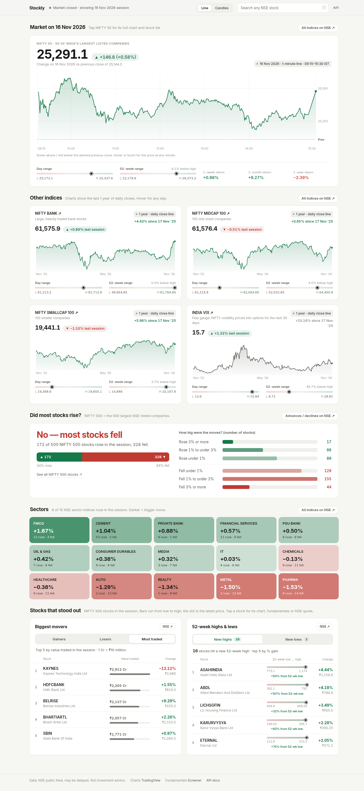
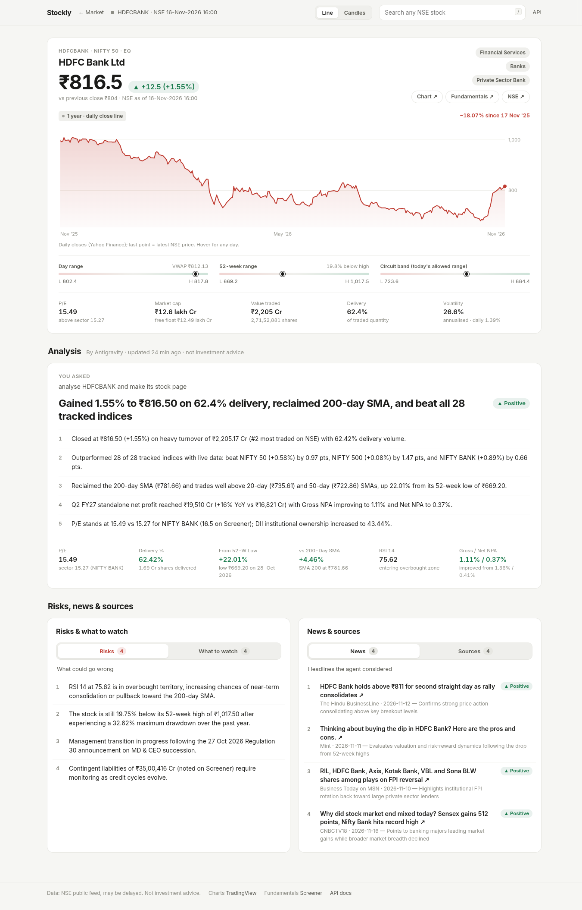

# Stockly

A live NSE market dashboard and a local API for AI  agents (Claude Code, Codex, opencode, Copilot).
Most agents research stocks through web search, which returns articles that can be days old.
Stockly gives your agent live market data straight from NSE (prices, indices, filings, fundamentals),
so its analysis reflects the market as it is right now.

**Home page**



**Sample analysis: HDFC Bank**



## Run

```bash
python3 -m venv stockly/venv
stockly/venv/bin/pip install -r stockly/requirements.txt
python start.py
```

| | |
|---|---|
| Dashboard | http://localhost:8000/ |
| Stock page | http://localhost:8000/stocks/TCS |
| API docs | http://localhost:8000/docs · [`stockly/API.md`](stockly/API.md) |

Agents read [`AGENTS.md`](AGENTS.md). Options: `--port`, `--no-browser`, `--offline`.

Data from NSE, Yahoo Finance and Screener.in; may be delayed. Not investment advice.

## License

CC BY-NC 4.0
